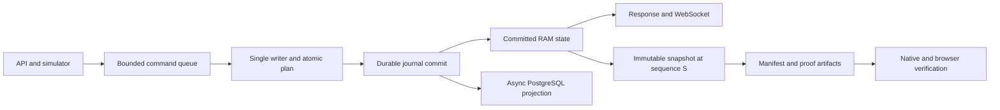
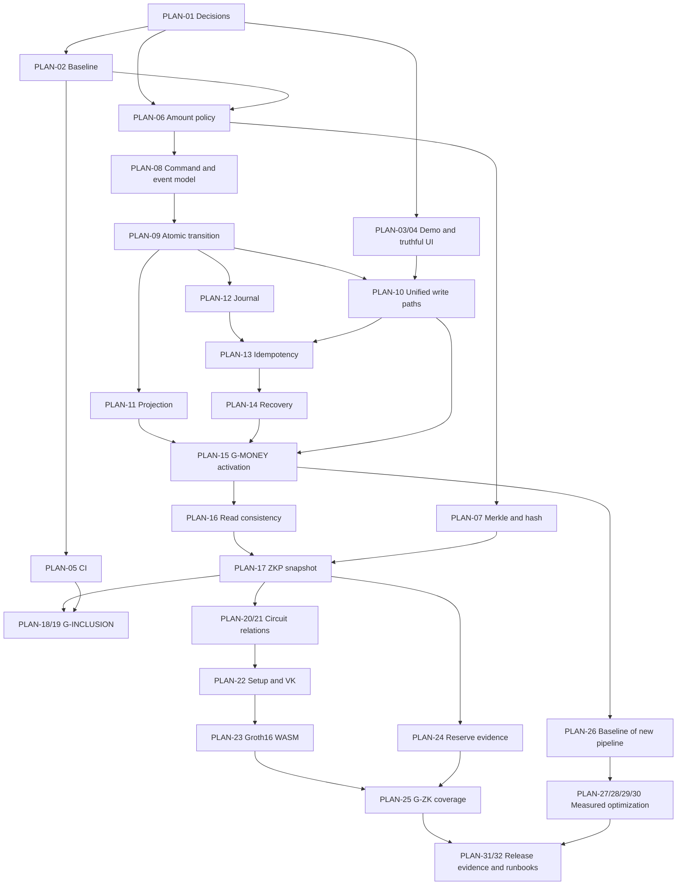

# Kế hoạch cải thiện SolvEx (CEX ZKP)

Ngày lập: **10/10/2026**. Nguồn: [IMPROVEMENT.md](IMPROVEMENT.md).

**Trạng thái: kế hoạch đề xuất; các công việc bên dưới chưa được thực hiện.** Yêu cầu hiện tại chỉ tạo tài liệu kế hoạch. Tên module, bảng, trường, endpoint và cấu hình mới là đề xuất tổ chức công việc, không phải mô tả rằng chúng đã tồn tại.

## 1. Mục tiêu, phạm vi và cách sử dụng

Mục tiêu là chuyển bảy nhóm điểm yếu trong tài liệu brainstorm thành các gói công việc có thứ tự, phụ thuộc, thành phần chịu tác động và điều kiện nghiệm thu. Ưu tiên tránh sai số dư, mất dữ liệu và kết quả xác minh sai; tối ưu hiệu năng sau khi bảo đảm các invariant nghiệp vụ.

Giữ Rust monolith, matching sync trong RAM, Decimal, Axum/Tokio, PostgreSQL/SQLx, Svelte/Vite, Arkworks và Docker Compose/Nginx theo [techstack.md](techstack.md). PostgreSQL vẫn là projection bất đồng bộ trong hướng mục tiêu. Matching không gọi SQL hoặc mạng; lớp điều phối có thể chờ journal bền vững trước khi trả thành công.

Phạm vi mặc định là demo cô lập, identity giả lập bằng `x-user-id`. Phân quyền mô phỏng ở server không biến header đó thành xác thực danh tính. Session thật hoặc credential quản trị mới thuộc nhánh mở rộng đặc tả, được ghi riêng ở mục 10; không mặc nhiên thêm JWT/OAuth hay đổi stack.

Mỗi gói có ID `PLAN-xx`. Khi triển khai, thực hiện theo bảng thứ tự ở mục 2, kiểm tra các phụ thuộc và hoàn thành tiêu chí nghiệm thu trước khi đánh dấu xong. Công việc có thể được phát triển độc lập bằng fixtures khi chưa đủ phụ thuộc, nhưng chưa được bật trên dữ liệu giao dịch sống trước cổng nghiệm thu tương ứng.

### 1.1. Quy ước ưu tiên và công sức

| Ký hiệu | Ý nghĩa |
|---|---|
| P0 | Cần hoàn tất trước khi tin cậy hoặc bật tính năng liên quan; lỗi có thể gây sai dữ liệu hoặc sai kết luận xác minh |
| P1 | Cần cho chất lượng, vận hành và mức tải mục tiêu; thực hiện sau các phụ thuộc P0, hoặc song song khi không tranh chấp |
| P2 | Tối ưu thêm khi có số đo hoặc yêu cầu rõ; không nằm trên đường hoàn thành tối thiểu |
| S / M / L / XL | Công sức tương đối: nhỏ / vừa / lớn / nhiều thành phần và rủi ro tích hợp; chưa phải ước lượng ngày công |

P0 cho phần solvency không có nghĩa triển khai trước ledger: mức độ quan trọng và thứ tự phụ thuộc là hai yếu tố khác nhau. Không đặt lịch theo ngày khi chưa biết quy mô nhóm, workload, giới hạn cây và quyết định storage.

### 1.2. Hướng kiến trúc mục tiêu

Một writer điều phối toàn bộ command thay đổi giá trị; validate và chuẩn bị thay đổi nguyên tử cho cả book/ledger/reservation. Một transaction record ghi kết quả đã quyết định vào journal; chỉ sau durable commit mới công bố state và ACK. PostgreSQL đọc journal để cập nhật bản phục vụ truy vấn với transaction, checkpoint và chống xử lý trùng.

Journal, dedup, projection và recovery có thể chia thành nhiều gói để lập trình, nhưng phải **cùng vượt cổng G-MONEY trước khi bật đường ghi mới**. Không phát hành một đường ACK dựa trên journal khi restart vẫn nạp state theo cơ chế cũ.

### 1.3. Điều kiện chung để nhận và kết thúc công việc

**Trước khi bắt đầu:** phụ thuộc liên quan đã có hợp đồng rõ; biết dữ liệu nào bị đổi, trường hợp lỗi mong đợi và cách kiểm chứng. Với circuit, cần chốt public inputs và privacy; với dữ liệu, cần chốt precision và durability.

**Trước khi hoàn thành:** có test đúng/sai thích hợp, không bỏ lỗi ngầm, có version/migration nếu format đổi, tài liệu phản ánh bảo đảm thực tế. Chỉ đánh dấu verified khi có bằng chứng chạy trên artifact hoặc storage phù hợp. Test xuất hiện cùng công việc, không đợi tới giai đoạn cuối.

## 2. Thứ tự triển khai tổng thể

| Thứ tự | Giai đoạn | Gói công việc | Lý do xếp trước/sau | Cổng |
|---|---|---|---|---|
| 0 | Chốt hợp đồng và baseline | PLAN-01, PLAN-02 | Tránh sửa đúng kỹ thuật nhưng sai nghiệp vụ; có test đối chiếu | G-BASE |
| 1 | Giảm rủi ro trực tiếp và có CI cơ bản | PLAN-03, PLAN-04, PLAN-05 | Cô lập demo, ngừng kết luận verify sai, bảo vệ các thay đổi tiếp theo | G-SAFE |
| 2 | Đúng số tiền; nền Merkle ở nhánh proof | PLAN-06, PLAN-07 | Accounting/proof dùng cùng lượng tài sản; PLAN-07 có thể song song và không chặn riêng mốc money | G-MATH |
| 3 | Một luồng thay đổi state nguyên tử | PLAN-08, PLAN-09, PLAN-10 | Loại race và cập nhật book/ledger một phần trước khi persist/replay | Tiền đề G-MONEY |
| 4 | Persistence bền vững, recovery và chuyển đổi | PLAN-11, PLAN-12, PLAN-13, PLAN-14, PLAN-15 | Không mất hoặc nhân đôi command đã chấp nhận; không trùng ID sau restart | G-MONEY |
| 5 | Dữ liệu đọc nhất quán và inclusion thật | PLAN-16, PLAN-17, PLAN-18, PLAN-19 | Proof phải xuất phát từ snapshot có ý nghĩa và được browser kiểm tra thật | G-INCLUSION |
| 6 | ZK và reserve coverage đúng phạm vi | PLAN-20, PLAN-21, PLAN-22, PLAN-23, PLAN-24, PLAN-25 | Circuit/key/reserves cần liên kết với snapshot đúng; không dùng inclusion thay tổng nợ | G-ZK |
| 7 | Đo và tối ưu có kiểm chứng | PLAN-26, PLAN-27, PLAN-28, PLAN-29, PLAN-30 | Tối ưu nơi đã đo là bottleneck, giữ nguyên tính đúng và durability | G-PERF |
| 8 | Tổng kiểm chứng và vận hành | PLAN-31, PLAN-32 | Thu thập bằng chứng cuối, diễn tập restore và bàn giao | G-RELEASE |

Có thể phát triển PLAN-07 bằng fixture song song với backend sau PLAN-06; PLAN-11 và PLAN-12 song song sau hợp đồng event; nghiên cứu circuit với fixture trước khi G-MONEY pass. Chỉ công bố proof từ ledger sống sau khi snapshot và nguồn state vượt các cổng tương ứng.

Nếu chỉ làm từng phần, mốc đầu tiên có thể bàn giao là demo cô lập và UI mô tả trung thực. Mốc tiếp theo là giao dịch có durability/recovery, rồi inclusion độc lập. Full ZK/coverage là mốc riêng; không gộp các mức đó thành một nhãn “đã hoàn thành ZKP”.

## 3. Các gói công việc chi tiết

### PLAN-01 — Chốt các quyết định và hợp đồng nghiệp vụ

**Ưu tiên:** P0. **Công sức:** M. **Phụ thuộc:** không. **Nhóm:** 1–7.

**Thành phần:** tài liệu kiến trúc, `docs/techstack.md`, quy tắc của engine/ledger/API/ZKP; đề xuất decision log trong `docs/`.

**Việc cần làm:**

1. Ghi quyết định về demo boundary, policy admin/suspension và các route chỉ dành cho test.
2. Chốt precision, tick/lot, notional, rounding phí, tài khoản phí/dust và giới hạn số tiền/ID.
3. Chọn nguồn commit: mặc định journal riêng trong monolith; ghi rõ tradeoff nếu chọn PostgreSQL journal và cập nhật ràng buộc DB ngoài ACK tương ứng.
4. Chốt success/timeout/retry semantics, idempotency retention và phạm vi bảo vệ khi crash so với mất volume.
5. Chốt statement inclusion/aggregate/coverage, dữ liệu được công khai, capacity cây và cách xác thực manifest/reserves.
6. Chốt cách chuyển dữ liệu cũ, có bảo tồn hay tạo demo mới; không suy ra dữ liệu thiếu từ các balance hiện có.

**Đầu ra:** decision log, bảng invariant, các ví dụ đúng/sai và danh sách quyết định chưa chốt kèm gói bị ảnh hưởng.

**Nghiệm thu:** mỗi quyết định còn mở có default đề xuất và điều kiện cần thay; không có hai nguồn settlement/rounding hoặc hai ý nghĩa ACK. Gói phụ thuộc không chạy vào triển khai format cuối khi quyết định liên quan còn mâu thuẫn.

### PLAN-02 — Thiết lập baseline và bộ kiểm chứng invariant

**Ưu tiên:** P0. **Công sức:** M. **Phụ thuộc:** PLAN-01. **Nhóm:** 4, 5, 6, 7.

**Thành phần:** tests engine/ledger/ZKP hiện có, `core/benches/engine_benchmark.rs`; đề xuất integration fixtures và test DB riêng.

**Việc cần làm:** ghi baseline từ source hiện tại; tạo fixtures nhiều user/asset, order partial/multi-fill, fees và reservation; tách checker khối lượng lệnh khỏi checker tài sản. Thiết kế failpoints cho SQL, journal, snapshot và request ACK. Các regression test mô tả lỗi hiện có có thể đang fail, nhưng trạng thái đó phải được ghi rõ; không giấu bằng cách bỏ test khỏi release gate.

**Invariant bắt buộc:** số dư không âm; remaining/filled hợp lệ; locked khớp reservations và holds; nội bộ bảo toàn từng asset kể cả fee/dust accounts; external inflow/outflow được hạch toán; một command không có state một phần; state có sequence duy nhất và replay được.

**Đầu ra:** test matrix và fixtures versioned; workload baseline; test harness tái sử dụng ở PLAN-09, PLAN-11–15 và PLAN-20–25.

**Nghiệm thu:** checker bắt được balance/fee/reservation bị sửa sai; báo cáo tách kết quả pass hiện tại và các failure đang chờ sửa. Không dùng 64 tests pass từ review cũ thay cho baseline triển khai mới.

### PLAN-03 — Cưỡng chế ranh giới demo và policy phía server

**Ưu tiên:** P0 nếu có truy cập ngoài mạng tin cậy; P1 cho demo local. **Công sức:** M. **Phụ thuộc:** PLAN-01. **Nhóm:** 1.

**Thành phần:** `api/auth.rs`, `router.rs`, `admin.rs`, `simulator.rs`, `main.rs`, Compose/Nginx, admin/auth stores.

**Việc cần làm:** định nghĩa mode/cấu hình; mặc định bind cổng cần thiết ở loopback, bỏ publish nội bộ khi không cần; route simulator/mock deposit/admin theo mode. Gom policy role/user existence/suspension ở backend. Không cấp quyền từ localStorage. Hạn chế mạng ở ingress/firewall thay vì suy ra caller là local từ địa chỉ Nginx. Dữ liệu cần giữ nhưng chưa có G-MONEY phải được bảo vệ bằng maintenance hoặc hạn chế các write path rủi ro theo chính sách đã chốt.

**Đầu ra:** policy matrix, cấu hình demo rõ, audit các thao tác đặc quyền. Tích hợp thứ tự suspend/halt với writer được hoàn tất ở PLAN-10.

**Nghiệm thu:** gọi HTTP trực tiếp qua backend/Nginx không bỏ qua policy; route test bị từ chối ngoài mode phù hợp; sửa localStorage không tạo quyền. Trong dummy auth vẫn ghi nhận khả năng mạo danh ID hợp lệ. Chỉ có tiêu chí chống giả header khi đã chọn thêm kênh quản trị độc lập ở nhánh mở rộng.

### PLAN-04 — Ngừng hiển thị kết quả xác minh và snapshot sai phạm vi

**Ưu tiên:** P0. **Công sức:** S–M. **Phụ thuộc:** PLAN-01. **Nhóm:** 2, 3, 7.

**Thành phần:** `ZkpVerifierPanel.svelte`, `ZkpExchangePanel.svelte`, `zkp-types.ts`, `zkp-verify.ts`, `api/admin.rs`, `api/zkp.rs`, README/WBS.

**Việc cần làm:** loại `snark.verified` khỏi quyết định trust của UI; khi chưa có verifier thật hiển thị chưa xác minh/không hỗ trợ. Đặt type/version sơ bộ cho payload và phân biệt inclusion, aggregate, reserves/coverage. Snapshot giả có trạng thái simulated riêng, không thuộc danh sách trusted snapshot. Viết trạng thái lỗi parse, unsupported version và WASM unavailable; thống nhất logic dùng chung thay vì hai bản parser.

**Đầu ra:** state machine UI đúng phạm vi; legacy payload chỉ xem thông tin, không nâng lên verified; roadmap mô tả thành phần hiện có theo prototype/integrated/verified.

**Nghiệm thu:** JSON chỉ có `verified: true` không báo valid; root mô phỏng không được dùng làm chứng cứ; lỗi loader không fallback true. Gói này sửa tính trung thực trước, chưa nghiệm thu browser verification thật.

### PLAN-05 — Build có lock và quality gate ban đầu

**Ưu tiên:** P1, thực hiện sớm để bảo vệ các P0. **Công sức:** M. **Phụ thuộc:** PLAN-02; có thể song song PLAN-03/04. **Nhóm:** 7.

**Thành phần:** `.gitignore`, Cargo.lock, package-lock, Dockerfiles, `web/package.json`, workflow trong `.github/workflows/`.

**Việc cần làm:** kiểm tra file thực sự tracked; khóa dependency/toolchain, dùng build locked và `npm ci`; đưa workflow vào Git. PR chạy format/lint/tests/check/build. Chuẩn bị PostgreSQL integration job riêng. Publish chỉ sau gates; quyền ghi package chỉ thuộc job publish. WASM artifact test được bổ sung ở PLAN-19/23 khi đường build tương ứng hoàn thiện.

**Đầu ra:** clone sạch có thể build; CI cơ bản với báo cáo test và known failures minh bạch, không badge tĩnh tạo tuyên bố giả.

**Nghiệm thu:** một test bắt buộc fail chặn publish; workflow tồn tại trong Git, không chỉ local; Docker và CI dùng cùng dependency graph. Không sửa migration lịch sử để làm test pass trên DB cũ.

### PLAN-06 — Chuẩn hóa số tiền, hạch toán và ID

**Ưu tiên:** P0. **Công sức:** L. **Phụ thuộc:** PLAN-01, PLAN-02. **Nhóm:** 3, 4, 5.

**Thành phần:** `engine/types.rs`, `ledger/mod.rs`, DTO order/wallet, DB schema/migrations, conversion ZKP; đề xuất module policy/amount dùng chung phù hợp ranh giới crate.

**Việc cần làm:** chốt mỗi asset một đơn vị nhỏ nhất; giữ Decimal nhưng validate precision trước mutation, chuyển sang integer units chính xác cho hash/circuit. Checked arithmetic cho notional/sum/fee. Ghi fee và dust đối ứng, external inflow/outflow; chỉ một policy rounding. Chốt miền ID tương thích BIGINT, checked cast và API string khi cần; config có version. Lập migration nếu policy không còn khớp NUMERIC hiện tại.

**Đầu ra:** amount/accounting contract và vectors dùng chung; các giới hạn công khai cho API/DB/ZKP.

**Nghiệm thu:** âm, zero không hợp lệ, quá precision, overflow và ID vượt miền bị từ chối trước khi sửa state; price improvement/fees/dust bảo toàn từng asset. Cùng giá trị có cùng units giữa RAM, SQL và hash; không dùng rescale để âm thầm làm tròn witness.

### PLAN-07 — Sửa Merkle Sum Tree, encoding và nền hash

**Ưu tiên:** P0 cho proof. **Công sức:** L. **Phụ thuộc:** PLAN-06, PLAN-04 về schema. **Nhóm:** 3.

**Thành phần:** `zkp/src/tree.rs`, `poseidon.rs`, `verifier.rs`, `circuit.rs` primitives; đề xuất protocol/amount helpers trong crate zkp.

**Việc cần làm:** zero padding tới capacity chuẩn, quy ước 0/1 leaf; canonical ordering, duplicate account/asset policy; domain riêng leaf/node/empty, asset/snapshot context. Chọn Poseidon parameters có nguồn và vectors cho đúng field/shape; version format khi hash thay. Parse ASCII hex/field/ID canonical, giới hạn path/file và không panic với Unicode. Liên kết biểu diễn bits–FpVar, ép carry đầu/cuối và sửa gadget sum/range trước khi tái dùng trong circuit.

**Đầu ra:** Merkle protocol mới, encoding/vectors và primitive constraints có tests đối kháng. Không chuyển root/proof cũ sang protocol mới bằng cách đổi nhãn.

**Nghiệm thu:** 10 + 5 + 7 = 22; root sum đúng cho N = 0, 1, 2, 3, 5, 6 và random theo quy ước cây rỗng. Padding có tiền, duplicate trái quy tắc, malformed hex, range/field không khớp, carry đầu 1 đều bị từ chối ở lớp phù hợp. MDS/constants có nguồn kiểm chứng; không coi deterministic public hash constants là lỗi secrecy của setup.

### PLAN-08 — Hợp đồng command, transaction record và state owner

**Ưu tiên:** P0. **Công sức:** L. **Phụ thuộc:** PLAN-01, PLAN-06. **Nhóm:** 4, 5, 6.

**Thành phần:** `api/state.rs`, engine/ledger, persistence events; đề xuất `core/src/exchange/` chứa command, state, event và writer.

**Việc cần làm:** xác định writer sở hữu book, ledger, ownership, counters, market/fee policy và reference price. Command có actor, request key/payload digest; transaction record có seq/version/timestamp, kết quả và toàn bộ delta/fills/fees. Định nghĩa queue bounded, result channel, read-state version và lifecycle event. Actor trong demo là danh tính khai báo, không mô tả thành đã xác thực.

**Đầu ra:** hợp đồng event đủ để apply/replay mà không tính lại fee/giá/thời gian; state machine prepared/committed/published và quy tắc lỗi.

**Nghiệm thu:** mọi nghiệp vụ thay đổi state có command tương ứng; record tự chứa maker/taker owner dù index được cleanup; serialization có version; queue full bị từ chối trước mutation. Dữ liệu chuẩn không phụ thuộc worker đọc ngược mutable ownership map.

### PLAN-09 — Atomic transition cho cả order và ledger

**Ưu tiên:** P0. **Công sức:** XL. **Phụ thuộc:** PLAN-02, PLAN-06, PLAN-08. **Nhóm:** 4, 6.

**Thành phần:** matching engine, ledger, command writer; đề xuất execution plan/write set hoặc staging overlay.

**Việc cần làm:** prepare toàn bộ order: reserve, nhiều fills, fees, refund, remaining, indices. Validate tất cả trước commit; chỉ stage các record bị tác động. Định nghĩa apply không còn lỗi nghiệp vụ bình thường, giữ FIFO/maker price/STP. Cung cấp event-apply dùng cho replay, tách khỏi matching một order mới.

**Đầu ra:** atomic business plan với delta quyết định một lần; không dùng clone toàn ledger cho mỗi fill làm bảo đảm cả order.

**Nghiệm thu:** lỗi ở fill cuối giữ nguyên book/balances/reservations nếu chưa commit; place/cancel/withdraw và hai market cùng USDT không tạo overdraft hoặc mất reservation; same-input committed state cho cùng plan. Matching không chứa I/O.

### PLAN-10 — Đưa mọi write path qua cùng writer và policy

**Ưu tiên:** P0. **Công sức:** L. **Phụ thuộc:** PLAN-03, PLAN-08, PLAN-09. **Nhóm:** 1, 4.

**Thành phần:** order/wallet/admin/simulator handlers, market/config updates, `main.rs`, API client.

**Việc cần làm:** đổi place/cancel/deposit/withdraw/transfer/treasury/simulator thành command; bỏ việc handler tự commit DB rồi mới sửa RAM. Register/bootstrap balances và thêm asset/account phải có thứ tự cùng state giao dịch, không tạo hai nguồn tài khoản. Halt/suspend/fee changes được version và kiểm tra lúc command thực thi. Audit actor/action/target/result cùng sequence; route read không sửa state.

**Đầu ra:** một đường authoritative cho mutation; policy simulator không bypass; inventory xác nhận các write path đã được chuyển hết.

**Nghiệm thu:** 100 USDT, reserve 80, withdraw 50 bị từ chối và không ghi nợ ở lớp nào; đồng thời suspend/halt và place có kết quả theo thứ tự xác định; không còn DB-before-RAM như một giao dịch độc lập. Chưa bật trên dữ liệu cần bảo toàn trước G-MONEY.

### PLAN-11 — Projection PostgreSQL nguyên tử và chống xử lý trùng

**Ưu tiên:** P0. **Công sức:** L. **Phụ thuộc:** PLAN-06, PLAN-08, PLAN-09; tích hợp PLAN-12. **Nhóm:** 4, 7.

**Thành phần:** `db/worker.rs`, schema/repositories, migrations mới; đề xuất applied-events/checkpoint, ledger entries, reservation/fee records.

**Việc cần làm:** project một transaction record trong một SQL transaction; claim event ID, ghi toàn bộ side effects và checkpoint cùng commit. Persist free/locked/reservation/fees/capital; check affected rows. Dùng delta đã quyết định, không tính settlement lần nữa. Retry transient errors, giữ checkpoint tại event lỗi; permanent errors dừng projection và báo lỗi. SQLx offline cache/query checking theo môi trường build đã chốt.

**Đầu ra:** projection có thể replay và rebuild; adapter/migration dữ liệu cũ ở PLAN-15.

**Nghiệm thu:** lỗi sau từng SQL rollback cả record; replay hai lần không cộng trùng trade, filled, balances, fees, volume. Không chỉ dedup insert trade trong khi vẫn chạy delta. Tắt DB không khiến worker xóa event chưa áp dụng khỏi nguồn bền vững. Bọc transaction worker cũ riêng lẻ chỉ là biện pháp tạm, không được tính G-MONEY pass.

### PLAN-12 — Durable journal và hợp đồng ACK

**Ưu tiên:** P0. **Công sức:** XL. **Phụ thuộc:** PLAN-08, PLAN-09; hợp đồng storage PLAN-01. **Nhóm:** 4, 5.

**Thành phần:** writer, runtime state, Compose volume; đề xuất `core/src/journal/` với framing, storage, replay reader và ownership lock.

**Việc cần làm:** append transaction record versioned có checksum/sequence/commit boundary; durable sync trước publish/ACK. Giữ một writer active; xử lý tail ghi dở, gap, checksum lỗi, disk full và ambiguous sync. Không thực hiện sync I/O dài trên HTTP executor. Queue RAM chỉ làm notification cho projection; quản lý dung lượng/lag và stop-write threshold.

**Đầu ra:** storage protocol, state machine lỗi và durable prefix cho recovery. Group commit là tối ưu sau khi correctness được chứng minh.

**Nghiệm thu:** failpoints trước/during/sau sync không ACK nhầm; durable record replay giữ kết quả dù crash trước apply RAM. Lỗi apply sau commit làm stop-write/recovery, không tiếp tục trên state lệch. Hợp đồng không hứa sống sót khi mất cả volume. Writer thứ hai bị chặn.

### PLAN-13 — Idempotency bền vững và hành vi client khi timeout

**Ưu tiên:** P0. **Công sức:** M–L. **Phụ thuộc:** PLAN-08, PLAN-10, PLAN-12; kết hợp PLAN-14. **Nhóm:** 4, 5.

**Thành phần:** writer/journal, order/wallet response, API client và form giao dịch; đề xuất outcome lookup theo request key.

**Việc cần làm:** scope key theo actor/action, canonical payload digest; persist outcome cùng transaction record. Cùng key/cùng payload trả outcome cũ; khác payload từ chối. Client retry giữ key cũ, không tự sinh key mới khi timeout. Definite rejection khác uncertain outcome; có cách tra trạng thái. Quy định retention và phản hồi sau expiry, không hứa retry vô hạn nếu outcome đã bị prune.

**Đầu ra:** request protocol và recovery dedup index; không có cửa sổ journal commit rồi dedup chỉ nằm RAM.

**Nghiệm thu:** timeout sau commit, retry trước/sau restart trả cùng order/result; hai request cùng key không chạy hai lần; key reused với payload khác fail; replay không phụ thuộc đồng hồ/fee config mới.

### PLAN-14 — Snapshot recovery, ID và readiness

**Ưu tiên:** P0. **Công sức:** XL. **Phụ thuộc:** PLAN-08, PLAN-09, PLAN-12, PLAN-13; tích hợp PLAN-11. **Nhóm:** 5.

**Thành phần:** `main.rs`, `api/state.rs`, engine restore, ledger load, journal; đề xuất `core/src/recovery/`.

**Việc cần làm:** snapshot toàn state tại S; chứa resting orders/FIFO, balances/holds/reservations, fee/capital, policy versions, counters/high-water mark và dedup. Publish snapshot sau durable write; giữ fallback. Replay từ S+1 qua event-apply không match lại. Rebuild indices, kiểm tra invariants, giữ liveness/readiness riêng; simulator chỉ chạy sau readiness. Xóa segment theo checkpoint recovery/projection/history/backup, không chỉ theo tuổi file.

**Đầu ra:** startup state machine recovering/ready/read-only/error, snapshot format và runbook restore cơ bản.

**Nghiệm thu:** nhiều restart giữ state hash/FIFO/remaining/fees/capital/IDs; dữ liệu cuối ghi dở khác corruption giữa log; gap/version/checksum lỗi chặn ghi. Không dùng MAX ID của DB đang trễ để cấp ID. Snapshot cũ thiếu history không đủ để rebuild mọi projection thì chưa được prune log liên quan.

### PLAN-15 — Đối soát dữ liệu cũ, diễn tập và bật đường ghi mới

**Ưu tiên:** P0. **Công sức:** L. **Phụ thuộc:** PLAN-06, PLAN-10, PLAN-11, PLAN-12, PLAN-13, PLAN-14. **Nhóm:** 4, 5, 7.

**Thành phần:** migrations/bootstrap, DB/journal volumes, runtime config; đề xuất reconciliation/cutover tools và runbook trong docs/scripts.

**Việc cần làm:** dừng ghi, backup, kiểm kê lệnh/số dư/reservations/phí/vốn; phân loại chênh lệch và chọn baseline đã đối soát. Không suy diễn phần lịch sử thiếu. Diễn tập cutover trên bản sao dữ liệu; xác nhận rollback compatibility trước khi bật. Chạy fault/concurrency tests với PostgreSQL thật và journal storage; kiểm tra project catch-up và backup restore. Chỉ activate khi G-MONEY pass.

**Đầu ra:** báo cáo reconciliation, baseline sequence, migration/cutover procedure và bằng chứng diễn tập.

**Nghiệm thu:** không mất command đã ACK trong crash model đã chốt; không nhân đôi mutation sau retry; baseline không tạo số dư bịa. Sau khi có giao dịch mới, rollback không restore snapshot trước cutover để xóa giao dịch: dừng ghi, giữ journal, dùng bản đọc schema tương thích hoặc fix-forward. `docker compose down -v` không phải chiến lược nâng cấp dữ liệu cần giữ.

### PLAN-16 — Read models, watermark và đồng bộ frontend

**Ưu tiên:** P0 cho dữ liệu snapshot; P1 cho trải nghiệm đọc. **Công sức:** M. **Phụ thuộc:** G-MONEY. **Nhóm:** 4, 6.

**Thành phần:** `api/data.rs`, `ws.rs`, writer read snapshots, `orderBookStore.ts`, wallet/order/history stores và API client.

**Việc cần làm:** đọc balance/order từ committed state; history từ DB có checkpoint. Response mang state sequence, DB last-applied sequence và trạng thái đang catch-up. WS mang sequence; REST snapshot không ghi đè dữ liệu mới hơn. Reconnect/gap có resync; recent trade history có backfill khi sản phẩm hứa đầy đủ.

**Đầu ra:** read consistency contract, client state transitions và invariant giữa trạng thái được hiển thị với nguồn dữ liệu.

**Nghiệm thu:** DB chậm không làm balance quay về số cũ; UI phân biệt history chưa project với lệnh không tồn tại; snapshot REST về muộn không ghi đè WS mới. Nếu dùng global sequence với subscription riêng, không coi khoảng trống do market khác là mất sự kiện; thiết kế cursor theo stream/snapshot boundary tương ứng.

### PLAN-17 — Snapshot ZKP bất biến và manifest

**Ưu tiên:** P0 cho dữ liệu proof. **Công sức:** L. **Phụ thuộc:** PLAN-07, PLAN-16, G-MONEY. **Nhóm:** 2, 3, 4, 5.

**Thành phần:** `api/zkp.rs`, `admin.rs`, snapshot repositories/migration mới; đề xuất `core/src/zkp/snapshot.rs` và `manifest.rs`.

**Việc cần làm:** chụp immutable ledger boundary S; build một tree cho mỗi asset/snapshot và lưu leaf set/order cùng metadata. Dùng writer snapshot để lấy đúng S, hoặc DB read snapshot có checkpoint trong cùng view đã chốt. Không chỉ đợi DB >= S rồi SELECT dữ liệu đang đổi. Publish manifest versioned gồm asset/unit/count/depth/root/root sum, sequence, hash/protocol và circuit/VK version nếu có. Snapshot queued/building/ready/failed; chỉ ready khi artifact và consistency checks xong. Root admin là root thật của pipeline này.

**Đầu ra:** immutable snapshot artifact, manifest có cơ chế xác thực nguồn đã chốt; pin khóa công bố nếu ký, quản lý version/rotation. Chữ ký của sàn không tự chống sàn công bố hai root khác nhau; thêm kênh lưu/công bố độc lập để giảm giả định đó nếu mục tiêu yêu cầu.

**Nghiệm thu:** mọi user cùng asset/snapshot nhận cùng root; giao dịch mới không đổi snapshot cũ; tính lại từ leaf set khớp tổng/root; root do proof upload tự khai không trở thành expected root. Snapshot recovery của PLAN-14 và snapshot ZKP có mục đích/retention khác nhau, không dùng thay nhau mặc định.

### PLAN-18 — API Merkle path và verifier WASM inclusion thật

**Ưu tiên:** P0. **Công sức:** L. **Phụ thuộc:** PLAN-04, PLAN-07, PLAN-17. **Nhóm:** 2, 3.

**Thành phần:** `api/zkp.rs`, `zkp/src/verifier.rs`, `lib.rs`, `zkp-wasm.ts`, `zkp-types.ts`, panel; đề xuất verifier worker trong web.

**Việc cần làm:** trả path và context đúng protocol mới; verifier tính lại leaf/hash/sums/direction rồi đối chiếu root/total/context trong manifest đã chọn. Parse ID qua chuỗi có kiểm tra miền, không dùng JS Number làm nguồn tiền. WASM hiện có là Merkle verifier, không đặt tên Groth16 verifier. Có resource limits và lỗi rõ; dùng Worker khi cần để tránh treo main thread.

**Đầu ra:** end-to-end Merkle inclusion có thể kiểm tra native/browser/offline; server boolean chỉ là diagnostic nếu còn giữ.

**Nghiệm thu:** native/WASM cùng kết quả; đổi balance/path/direction/root/account/context đã cam kết phải fail; Unicode/JSON sai không panic; WASM lỗi không báo valid. Không kết luận toàn cây nonnegative hoặc đầy đủ liabilities từ một path cá nhân.

### PLAN-19 — Nghiệm thu inclusion trên production bundle và chuyển version

**Ưu tiên:** P0 để công bố browser verification. **Công sức:** M. **Phụ thuộc:** PLAN-05, PLAN-18. **Nhóm:** 2, 3, 7.

**Thành phần:** frontend build, WASM artifact, Docker/Nginx, CI, proof cache và manifest.

**Việc cần làm:** build WASM từ source đúng version, đóng gói wrapper/binary/protocol digest đồng bộ. Browser test bundle release với verifier thật, không mock true. Kiểm kê payload/root/proof/cache cũ; đưa về legacy view-only, tạo snapshot mới sau đổi padding/precision/hash. Không fallback legacy khi version mới verify fail. Cung cấp verifier/fixtures offline để giảm phụ thuộc JS do sàn phát động.

**Đầu ra:** release artifact inclusion, migration matrix và chứng cứ tests production/offline.

**Nghiệm thu:** thiếu file, fetch lỗi, MIME/encoding/version không đúng, binary cũ đi với wrapper mới đều không báo valid; proof giả `verified:true` bị từ chối. UI chỉ công bố “inclusion thuộc snapshot X”, ghi rõ balance/sibling sums được lộ.

### PLAN-20 — Circuit membership có ràng buộc đầy đủ

**Ưu tiên:** P0 cho statement ZK membership. **Công sức:** XL. **Phụ thuộc:** PLAN-01 privacy/statement, PLAN-07, PLAN-17; dùng PLAN-18 vectors đối chiếu. **Nhóm:** 3.

**Thành phần:** `snark.rs`, `circuit.rs`; đề xuất tách `zkp/src/circuits/membership.rs` và gadgets amount/Merkle.

**Việc cần làm:** public inputs theo statement đã chốt: root, asset/snapshot context, user/account commitment và tổng nếu liên quan. Witness: balance/opening, path, sibling hash/sum và direction. Tính leaf/parents trong circuit, range-check đúng các biến đi vào hash/sum, enforce root cuối. Context phải tham gia constraints, không chỉ khai báo input. Nếu cần privacy, dùng commitment có blinding và thiết kế cách phân phối/giữ opening; response không công khai witness đó.

**Đầu ra:** circuit relation và specification public-input order; chưa sinh setup chính thức khi shape/constraints còn thay.

**Nghiệm thu:** tests witness độc hại bỏ qua wrapper: FpVar khác bits, carry sai, modulo-wrap, direction sai hoặc public context thay đều fail. Proof membership không được trình bày là aggregate proof. Có review constraint-level ngoài tests chỉ chạy constructor honest witness.

### PLAN-21 — Circuit tổng liabilities của toàn tập cam kết

**Ưu tiên:** P0 cho aggregate/solvency. **Công sức:** XL. **Phụ thuộc:** PLAN-20 gadgets, PLAN-17; capacity PLAN-01. **Nhóm:** 3.

**Thành phần:** đề xuất `zkp/src/circuits/liabilities.rs`, tree protocol, snapshot records.

**Việc cần làm:** full-tree circuit theo capacity nhỏ phù hợp đồ án; ràng buộc mọi leaf không âm/range, zero padding, hash/sum và total dưới cùng root/context. Enforce canonical distinct accounts nếu statement hứa không trùng, hoặc công bố attestation phụ trợ nếu chưa chứng minh tính đó. Dữ liệu leaf nằm dưới root không được chọn subset khác khi tính L. Đo constraints/prove cost trước khi xét recursion/batching.

**Đầu ra:** aggregate relation liên kết public root với L hoặc commitment của L; chi phí theo capacity và giới hạn dữ liệu.

**Nghiệm thu:** âm, overflow, padding có tiền, duplicate trái statement, thiếu/trùng nhánh, sửa subtotal/root/total đều fail. Full-tree proof bảo đảm tập đã cam kết đúng theo statement, không tự biết sàn bỏ nợ ngoài dataset. Nếu capacity không đáp ứng, giảm quy mô có nhãn hoặc chọn audited aggregation branch; không gọi nhánh attestation là full ZK aggregate.

### PLAN-22 — Chốt circuit, trusted setup và vòng đời tham số

**Ưu tiên:** P0 trước mọi trusted Groth16 release. **Công sức:** L. **Phụ thuộc:** PLAN-07 parameters, PLAN-20, PLAN-21; có thể setup membership riêng sau PLAN-20 nhưng chưa công bố aggregate. **Nhóm:** 3.

**Thành phần:** `snark.rs`, parameter artifacts/config; đề xuất setup tool offline, registry và artifact manifest.

**Việc cần làm:** review/freeze circuit shape/public inputs; sinh PK/VK offline với randomness mật mã, không seed 42. Chốt giả định một bên nghiên cứu hoặc ceremony nhiều bên phù hợp mục tiêu. Lưu transcript/metadata, circuit/VK hash, capacity/precision/hash version và verifier compatibility. Runtime load key, không setup khi request đầu hoặc restart. Chính sách rotation/retirement tách key publisher manifest khỏi VK của circuit.

**Đầu ra:** bộ tham số có nguồn gốc/version, quy trình generate/verify/publish và key registry allowlist.

**Nghiệm thu:** key không đổi sau restart; circuit đổi có version/key mới; proof seed 42 cũ không được nâng cấp thành trusted proof. PK/VK không bị nhầm là trapdoor; việc bảo vệ/hủy setup secret và giả định tin cậy được ghi rõ. Không coi riêng việc thay RNG là đã audit circuit.

### PLAN-23 — Groth16 verifier native và WASM thực sự

**Ưu tiên:** P0 cho ZK browser verification. **Công sức:** L. **Phụ thuộc:** PLAN-20, PLAN-22; PLAN-21 khi hiển thị aggregate; CI PLAN-05/19. **Nhóm:** 2, 3, 7.

**Thành phần:** `zkp/Cargo.toml`, `lib.rs`, native prover/verifier, WASM loader/Worker, UI.

**Việc cần làm:** tách verify-only code/dependency khỏi native prover; kiểm tra feature/serialization theo phiên bản Arkworks đang dùng. Decode canonical points/field/subgroup và số public inputs/trailing bytes; chọn VK theo allowlist đã pin, không tin VK tùy ý trong proof. Đối chiếu metadata hiển thị với actual public inputs. Build native/WASM cùng fixtures, quản lý cache artifact/VK/protocol/circuit.

**Đầu ra:** independent Groth16 verification trong browser; membership và aggregate có trạng thái riêng.

**Nghiệm thu:** native/browser/offline cùng kết quả; byte proof sai, VK khác, public-input order/length/context sai, unsupported scheme và lỗi tải không báo valid. Một SNARK đúng chỉ được công bố statement mà circuit thực sự ràng buộc, không nâng lên reserve coverage.

### PLAN-24 — Reserves evidence có nguồn và context

**Ưu tiên:** P0 nếu tuyên bố coverage thật; mô phỏng chỉ cần nhãn rõ từ PLAN-04. **Công sức:** L–XL theo nguồn tài sản. **Phụ thuộc:** PLAN-01 về scope, PLAN-17. **Nhóm:** 3.

**Thành phần:** `api/zkp.rs`, treasury/config, snapshot manifest; đề xuất `core/src/zkp/reserves.rs`.

**Việc cần làm:** tách simulated và evidenced reserves. Với on-chain: chain/token/address/block/hash, nguồn số dư kiểm chứng độc lập, bằng chứng kiểm soát thích hợp, confirmations/reorg, anti-double-count và thời hạn. Với off-chain: định dạng attestation và bên được tin cậy. Gắn evidence với asset/unit/thời điểm snapshot; định nghĩa pending withdrawals/holds để không bỏ hoặc đếm hai lần liabilities. Đây là bằng chứng reserves, không thay dummy login bằng wallet auth.

**Đầu ra:** evidence envelope và verifier policy; không chọn provider/network cụ thể khi chưa có yêu cầu. Nếu nguồn ngoài chưa có, gói ở trạng thái blocked-by-evidence trong kế hoạch và không bật nhãn reserves verified.

**Nghiệm thu:** query `cold_wallet_assets` không tạo evidenced status; dữ liệu cũ, sai chain/token/block, trùng asset/address hoặc thiếu kiểm soát bị từ chối theo policy. Không hứa evidence chứng minh tài sản chưa bị thế chấp/vay tạm hoặc trạng thái tương lai.

### PLAN-25 — Kết luận coverage và đối soát tính đầy đủ

**Ưu tiên:** P0 cho kết luận solvency. **Công sức:** L. **Phụ thuộc:** PLAN-21, PLAN-23, PLAN-24, PLAN-17. **Nhóm:** 3, 7.

**Thành phần:** manifest, coverage service/verifier, ZKP panels, reconciliation/reporting.

**Việc cần làm:** liên kết inclusion/aggregate và reserves với cùng asset/context; nếu L/R công khai đã xác thực, so sánh exact integer ngoài circuit. Nếu cần giấu tổng, thiết kế thêm commitment-linked inequality circuit rồi quay lại freeze/setup/version cho circuit mới. Đối soát registered accounts, ledger entries và nghĩa vụ được định nghĩa; có kiểm tra omission hoặc attestation ngoài hệ thống theo scope. Công bố manifest/snapshot trên kênh lưu độc lập nếu cần phát hiện equivocation.

**Đầu ra:** báo cáo coverage với thời điểm/asset/giả định, không phải boolean global cho mọi tài sản.

**Nghiệm thu:** chỉ báo coverage đạt khi aggregate đúng và reserves evidence phù hợp; thiếu một phần phải hiển thị chưa xác nhận. L > R ra coverage không đạt; không cộng BTC/ETH/USDT trực tiếp. Tài liệu và UI không hứa cryptography bảo đảm mọi nghĩa vụ ngoài tập được biết tới. Bản verifier độc lập xác nhận được các statement công bố.

### PLAN-26 — Baseline toàn hệ thống và mục tiêu hiệu năng

**Ưu tiên:** P1; thu thập số liệu sớm ở PLAN-02, phân tích hệ mới tại đây. **Công sức:** M. **Phụ thuộc:** G-MONEY; G-INCLUSION/G-ZK cho workload proof tương ứng. **Nhóm:** 6, 7.

**Thành phần:** metrics/Grafana, benchmark harness, queue/journal/projection/proof workers.

**Việc cần làm:** đo p50/p95/p99 queue wait, matching, settlement, durable commit và HTTP; throughput, RSS/memory slope, backlog/projection lag, recovery và prove/verify time. Ghi hardware/build/state size; phân loại nhiều user/market/maker/DB chậm. Chốt target sau số đo và công suất/storage đã chọn, có dung sai cùng cách đo để so trước/sau.

**Đầu ra:** performance budget cho từng stage và danh sách bottleneck; stop-write/resource metrics tối thiểu đã phải có từ PLAN-12/14, không đợi gói này.

**Nghiệm thu:** báo cáo tái lập được và tách engine microbenchmark khỏi API durability latency; không đưa target chưa đo vào README như một SLA đã đạt.

### PLAN-27 — Index, metadata cache và lifecycle state

**Ưu tiên:** P1 khi số đo xác nhận bottleneck. **Công sức:** M–L. **Phụ thuộc:** PLAN-09, PLAN-10, PLAN-14, PLAN-26. **Nhóm:** 6.

**Thành phần:** ledger/engine user indices, ownership map, market/config state, recovery.

**Việc cần làm:** index balances/open orders theo user, cleanup active order metadata, cache market/policy version. Updates/rebuild index nằm trong command/recovery boundary. Benchmark touched write set, không trade correctness lấy tốc độ. Không shard writers theo market trước khi giải quyết quote balance chung.

**Đầu ra:** read/index complexity giảm, memory không tăng vô hạn theo order history.

**Nghiệm thu:** thêm nhiều account không tham gia không làm settlement tăng theo toàn ledger; state/index sau replay nhất quán; cleanup không làm worker mất ownership; halt/config command không bị cache cũ bỏ qua.

### PLAN-28 — Batch projection và candle projection riêng

**Ưu tiên:** P1/P2 theo round-trip/lag. **Công sức:** M. **Phụ thuộc:** PLAN-11, PLAN-12, PLAN-26. **Nhóm:** 4, 6.

**Thành phần:** SQL worker/repositories, candles, metrics/checkpoints.

**Việc cần làm:** batch/prepared/bulk theo số đo, giữ transaction và dedup boundary; không tăng checkpoint ngoài commit. Tách chart projection nếu cần; dùng execution timestamp từ event và checkpoint/retention riêng. Group commit journal nếu cần là thay đổi riêng với test ACK boundary, không suy ra từ SQL batching.

**Đầu ra:** giảm DB round trips và lag mà không mất replayability.

**Nghiệm thu:** retry batch không tăng volume/filled/phí hai lần; candle replay giữ đúng kỳ; chart lỗi không mất ledger event; batch lớn không gây lock/latency ngoài budget. Prune log phải tính checkpoint chart/history riêng.

### PLAN-29 — Bounded proof workers và snapshot/cache reuse

**Ưu tiên:** P1; resource limits tối thiểu có ngay từ PLAN-17/18/23. **Công sức:** M. **Phụ thuộc:** PLAN-17, PLAN-18, PLAN-26; PLAN-23 khi phục vụ SNARK. **Nhóm:** 6.

**Thành phần:** snapshot/prover service, request API, cache, WASM Worker.

**Việc cần làm:** build tree một lần mỗi snapshot; CPU jobs qua bounded pool; quota/queue/cancellation semantics rõ. Cache theo snapshot/asset/user/protocol/circuit/VK và witness liên quan; TTL/eviction theo budget, không trả root khác để tăng hit rate. Một request HTTP bị hủy không mặc nhiên dừng tác vụ CPU đã chạy.

**Đầu ra:** proof workload không chiếm vô hạn CPU/RAM hoặc làm HTTP executor bị chặn.

**Nghiệm thu:** nhiều request cùng snapshot reuse artifact đúng; flood proof không phá latency/balance correctness; cache stale/version mismatch bị loại; snapshot freshness được hiển thị rõ.

### PLAN-30 — WebSocket subscription, coalescing và resync

**Ưu tiên:** P1/P2 theo số connection và bandwidth. **Công sức:** M. **Phụ thuộc:** PLAN-16, PLAN-26. **Nhóm:** 6.

**Thành phần:** `api/ws.rs`, broadcast/read state, order book/market stores.

**Việc cần làm:** subscription theo market nếu cần; coalesce depth snapshots trên interval đã đo; giữ trade/order outcome và cursors đúng. Snapshot có boundary, client gap/reconnect fetch lại đúng stream; recent trades backfill nếu cần. Giới hạn slow connections/queues và cleanup khi disconnect.

**Đầu ra:** ít serialize/broadcast hơn nhưng client vẫn hiểu được tính đầy đủ/độ cũ của dữ liệu.

**Nghiệm thu:** slow client không cản writer; coalescing không thay semantics ACK/trade; unsubscribe/disconnect không để reconnect/subscription rò rỉ; state cũ không ghi đè state mới sau resync.

### PLAN-31 — Tổng kiểm chứng và hồ sơ release

**Ưu tiên:** P0 trước công bố bảo đảm của mốc được chọn. **Công sức:** L. **Phụ thuộc:** các gói của mốc release; tests được xây xuyên suốt. **Nhóm:** 1–7.

**Thành phần:** CI, integration/fault/browser suites, release artifacts, tài liệu nghiệm thu.

**Việc cần làm:** chạy ma trận acceptance ở mục 7 trên artifact/storage thật; proof vectors versioned, PostgreSQL rollback, concurrency, hard crash, recovery và browser bundle. Báo pass/fail/không áp dụng cùng rationale. Test failing chặn publish; review security/crypto phù hợp scope. Không dùng việc mock verifier trả true hoặc shutdown đẹp làm bằng chứng.

**Đầu ra:** release evidence cho G-MONEY, G-INCLUSION, G-ZK hoặc G-PERF tương ứng; digest/version/config của artifact đã test.

**Nghiệm thu:** bảo đảm được công bố dẫn tới test/report cụ thể; stage thiếu evidence bị giữ lại. Các tests G-MONEY phải chạy trước PLAN-15 activation, không chờ tới cuối PLAN-31 mới bắt đầu kiểm thử storage.

### PLAN-32 — Runbook, restore rehearsal và cập nhật trạng thái dự án

**Ưu tiên:** P1, phần recovery/cutover tối thiểu là P0 trước G-MONEY. **Công sức:** M. **Phụ thuộc:** PLAN-15; các feature được bàn giao ở PLAN-19/25/31. **Nhóm:** 5, 7.

**Thành phần:** README, `docs/techstack.md`, WBS, monitoring, operational scripts; đề xuất runbooks trong docs.

**Việc cần làm:** tài liệu startup/readiness, DB down, projection stalled, disk full, journal corruption, backup/restore, schema upgrade và parameter retirement. Diễn tập restore thật; ghi RPO/RTO theo failure model đã đo. Đồng bộ prototype/integrated/verified, badge thật và scope identity/proof. Checklist bảo tồn dữ liệu thay vì reset volume mặc định.

**Đầu ra:** tài liệu bàn giao và evidence restore; cập nhật roadmap theo phần đã được chứng minh, không chỉ tồn tại file.

**Nghiệm thu:** người khác thực hiện được runbook trên môi trường test; không dùng rollback làm mất giao dịch đã ACK; mỗi nhãn DONE/verified có bằng chứng tương ứng. Mô tả rõ giới hạn khi volume/máy mất và các nghĩa vụ ngoài dataset.

## 4. Bản đồ phụ thuộc và những việc có thể làm song song

Sơ đồ thể hiện các phụ thuộc chính; danh sách phụ thuộc ở từng gói là đầy đủ hơn. Nhánh full ZK và reserve evidence không chặn việc bàn giao inclusion đã kiểm chứng. Tương tự, tối ưu P2 không chặn một release đã đạt target mà không cần tối ưu đó.

| Có thể làm song song | Điều kiện để tránh xung đột |
|---|---|
| Demo/policy, UI labels, CI ban đầu | PLAN-01 scope rõ; các thay đổi không được báo rằng ledger/proof đã an toàn |
| Ledger command design và Merkle/hash | Chốt amount/precision contract trước; dùng chung vectors, không tự chọn rounding khác |
| SQL projection và journal storage | Cùng transaction record/schema; fixtures và checkpoint contract đã chốt |
| Circuit research với backend durability | Dùng snapshots fixture bất biến; chưa công bố proof từ dữ liệu sống chưa đối soát |
| Reserve evidence và Groth16 verifier | Chốt asset/time/manifest contract; coverage chỉ bật khi cả hai nhánh nghiệm thu |
| Index, SQL batch, proof worker, WS optimization | Mỗi nhánh có baseline và correctness tests; tránh đồng thời sửa cùng state/event semantics |

Với một người triển khai, đi theo thứ tự bảng mục 2. Với nhiều người, chia theo thành phần nhưng không để hai nhóm phát minh protocol tiền/event/proof độc lập. Cần một người chịu trách nhiệm tích hợp G-MONEY và một người review constraints/protocol ở G-ZK; không gán tên cá nhân khi chưa biết nhân sự.

## 5. Các cổng nghiệm thu và quyền bật tính năng

| Cổng | Điều kiện bắt buộc | Sau khi pass được phép công bố/bật | Còn phải giữ giới hạn |
|---|---|---|---|
| G-BASE | PLAN-01/02: hợp đồng, fixtures, baseline, known failures | Bắt đầu các gói phụ thuộc với contract đã chốt | Chưa có bảo đảm tài chính mới |
| G-SAFE | PLAN-03/04/05: demo boundary, truthful UI, CI cơ bản | Demo cô lập và trình bày đúng phạm vi | Dummy identity vẫn giả mạo được; verifier có thể chưa sẵn sàng |
| G-MATH | PLAN-06/07: units/rounding/range, total/padding, encoding/vectors | Dùng format/primitive mới trong tests và fixtures | Chưa tự làm dữ liệu sống durable hoặc đầy đủ |
| G-MONEY | PLAN-06 và PLAN-08–15 tích hợp; concurrency/fault/replay/restore tests pass; volume/config đúng | Luồng giao dịch mới có hợp đồng ACK/durability đã định | Giới hạn process-crash model, không hứa sống sót khi mất volume |
| G-INCLUSION | PLAN-16–19, G-MONEY, G-MATH; manifest/snapshot/WASM/browser artifact pass | Inclusion độc lập cho snapshot được chọn | Không gọi đó là aggregate validity hoặc full solvency |
| G-ZK | PLAN-20–25; circuits/keys/verifier/reserve evidence phù hợp; review statement | Các statement ZK và coverage theo asset/snapshot đã xác nhận | Completeness, custody/encumbrance và tương lai vẫn theo giả định đã nêu |
| G-PERF | PLAN-26 và các tối ưu thực sự cần; correctness gates không regress | Target đã đo trong workload/giới hạn công bố | Không suy diễn sang hardware/workload khác |
| G-RELEASE | PLAN-31/32 cho mốc được chọn; CI, artifact, migration, runbooks và backup rehearsal | Bàn giao đúng mốc đã đạt | Feature chưa qua gate vẫn disabled/unverified |

G-MONEY là gate tích hợp, không được thay bằng “unit test journal pass”. Một demo cũ có CI pass cũng không được coi đã đạt gate này. G-MONEY cần amount/accounting ở PLAN-06, nhưng không bị chặn bởi tree/circuit ở PLAN-07 hoặc full ZK. G-RELEASE có thể áp dụng cho money-only hoặc inclusion-only release; không phải mọi release đều phải chờ full ZK hay các P2.

Nếu G-ZK chưa có reserve evidence, có thể công bố membership/aggregate đã kiểm chứng tương ứng nhưng **không công bố reserve coverage verified**. Nếu chọn audited aggregation thay full-tree circuit, đổi statement/release scope rõ và dùng gate cho mô hình tin cậy đó; không đánh dấu full ZK gate theo nghĩa cũ là đã pass.

## 6. Thành phần chịu tác động và đầu ra dự kiến

Các link trong bảng trỏ tới thư mục/tệp hiện có. Các đường dẫn mới viết dưới dạng code là **đề xuất**; chỉ tạo khi triển khai gói tương ứng.

| Thành phần hiện có | Gói chính | Trách nhiệm/đầu ra mới dự kiến |
|---|---|---|
| [core/src/engine](../core/src/engine/) | PLAN-06/09/14/27 | Matching thuần, prepare/restore, FIFO và user index có kiểm chứng |
| [core/src/ledger](../core/src/ledger/) | PLAN-06/09/10/14/27 | Accounting, reservations/holds/fees, atomic write set và replay |
| [core/src/api](../core/src/api/) | PLAN-03/08/10/13/16/17/24/25/30 | Policy, command adapters, read watermark, proof/evidence và WS contract |
| [core/src/db](../core/src/db/) | PLAN-11/15/16/17/28 | Projection transaction/dedup/checkpoint, immutable snapshot repository |
| [core/migrations](../core/migrations/) | PLAN-06/11/15/17 | Append migrations cho accounts/entries/events/reservations/snapshot metadata nếu cần; không sửa lịch sử đã áp dụng |
| [core/src/main.rs](../core/src/main.rs) | PLAN-03/10/12/14/15 | Bootstrap recovery, readiness, một writer active; simulator không bypass |
| [core/src/observability](../core/src/observability/) | PLAN-12/14/26/28/29 | Queue/storage/projection/readiness/proof metrics và failure states |
| [zkp/src](../zkp/src/) và [zkp/Cargo.toml](../zkp/Cargo.toml) | PLAN-07/18/20–23 | Protocol, hash/amount gadgets, circuits và native/WASM verification |
| [web/src/lib](../web/src/lib/) | PLAN-04/13/18/19/23 | Proof schema, trusted-context verifier/Worker, request retry identity |
| [web/src/stores](../web/src/stores/) | PLAN-03/16/30 | Demo policy display, sequence/watermark/resync và cleanup |
| [web/src/components](../web/src/components/) | PLAN-04/13/16/18/23/25 | UI đúng statement, timeout/verification/evidence states riêng |
| [Docker Compose](../docker-compose.yml), Dockerfiles, [Nginx](../web/nginx/default.conf) | PLAN-03/05/12/19/23 | Network boundary, durable volume, reproducible builds và artifact serving |
| [docker monitoring](../docker/) | PLAN-26/32 | Dashboards/alerts gắn failure model và operational budget |
| [docs](./), README, WBS | PLAN-01/04/15/31/32 | Decision log, migration/runbooks, test evidence và trạng thái đúng phạm vi |

Đề xuất module mới để cân nhắc: `core/src/exchange/`, `core/src/journal/`, `core/src/recovery/`, `core/src/zkp/`, `zkp/src/circuits/`, `zkp/src/gadgets/` và verifier Worker trong `web/src/lib/`. Có thể thay cách chia file nếu module hiện có đủ rõ; cần giữ ranh giới ownership/side effects, không tạo thêm kiến trúc chỉ để theo tên trong kế hoạch.

## 7. Ma trận tiêu chí nghiệm thu bắt buộc

Ma trận này liên kết tiêu chí với gói triển khai và loại bằng chứng. Khi làm việc thực tế, thay trạng thái bằng liên kết test/report; không đánh dấu pass chỉ vì đã viết một hàm.

| ID | Tình huống cần chứng minh | Gói | Bằng chứng/gate |
|---|---|---|---|
| AT-01 | Mode/ingress chặn route demo và backend trực tiếp áp dụng policy; localStorage không cấp quyền | PLAN-03/10 | API + ingress integration; G-SAFE |
| AT-02 | Suspend/halt và order đồng thời có thứ tự; quyền read/cancel/withdraw theo policy | PLAN-03/10 | Command/API concurrency; G-MONEY |
| AT-03 | `verified:true` giả, legacy payload và WASM lỗi không tạo kết quả valid | PLAN-04/18/19/23 | Browser production bundle, không mock verifier |
| AT-04 | Root sum bằng tổng thật, zero padding/cây 0/1/lẻ, duplicate/canonical encoding đúng | PLAN-06/07 | Native/property vectors; G-MATH |
| AT-05 | Precision/negative/overflow/ID conversion và fee/dust rules được cưỡng chế | PLAN-06/09 | Boundary/domain/SQL/hash tests |
| AT-06 | 100 reserve 80 withdraw 50; lỗi fill cuối; multi-market cùng USDT không partial/overdraft | PLAN-09/10 | Property + concurrency; G-MONEY |
| AT-07 | Lỗi từng SQL rollback whole record; replay không nhân đôi trade/filled/balance/fee/candle | PLAN-11/28 | PostgreSQL thật + failpoints |
| AT-08 | Crash trước/during/sau journal sync; commit trước ACK; retry timeout trả outcome cũ | PLAN-12/13/15 | Hard-crash/fault tests; G-MONEY |
| AT-09 | Restart giữ FIFO/remaining/reservations/fees/capital/IDs/dedup; restore không khớp thêm | PLAN-14/15 | Replay state digest + restore rehearsal |
| AT-10 | Checksum/gap/version/disk-full/volume/writer thứ hai thất bại rõ, không ACK sai | PLAN-12/14/15 | Storage/failure-mode tests và readiness |
| AT-11 | DB chậm, REST về muộn, WS gap/reconnect không làm balance/depth lùi hoặc ngầm mất history | PLAN-16/30 | API/browser/slow-client tests |
| AT-12 | Snapshot đúng S, bất biến, một root cho cùng context; admin root thật; manifest source được kiểm tra | PLAN-17 | Boundary capture + recompute/manifest tests |
| AT-13 | Thay path/balance/user/root/asset/snapshot đã cam kết làm inclusion fail; native/WASM/offline khớp | PLAN-18/19 | Vectors + release browser; G-INCLUSION |
| AT-14 | Witness bits/field/carry/range/root/total/duplicate/padding đối kháng fail | PLAN-07/20/21 | R1CS adversarial tests + review |
| AT-15 | Seed 42 legacy không trusted; restart không setup lại; key/context/curve/subgroup/inputs sai fail | PLAN-22/23 | Parameter provenance + native/browser verify |
| AT-16 | Query reserves không thành evidence; stale/sai asset/block/trùng evidence bị phát hiện | PLAN-24 | Evidence fixtures/integration theo nguồn |
| AT-17 | Coverage cần aggregate + evidence cùng context; L > R fail, thiếu evidence unverified | PLAN-25 | Composition/metadata tests; G-ZK |
| AT-18 | Clone sạch build backend/web/WASM có lock; mandatory test fail chặn publish | PLAN-05/19/23/31 | CI/Git/build artifact evidence |
| AT-19 | CPU/RAM/queue/projection limits và targets đã đo không regress invariant | PLAN-26–30 | Load/benchmark + correctness suite; G-PERF |
| AT-20 | Upgrade/rollback/restore không mất command đã ACK; DONE/verified có test và runbook | PLAN-15/31/32 | Migration/restore rehearsal; G-RELEASE |

Mỗi asset được kiểm tra riêng về bảo toàn. Crash tests phải bao gồm process chết không sạch; crypto tests phải bao gồm prover/witness sai không đi qua constructor honest. Các tình huống lỗi được chạy trên database/volume test, không trên dữ liệu cần giữ.

## 8. Đối chiếu với bảy nhóm điểm yếu ban đầu

| Nhóm trong IMPROVEMENT.md | Gói khắc phục | Điều kiện coi đã xử lý |
|---|---|---|
| 1. Identity/admin/demo | PLAN-01/03/10/32; auth thật là nhánh riêng | Demo boundary và policy được kiểm chứng; hạn chế impersonation được trình bày đúng hoặc auth scope đã thay |
| 2. Browser tin boolean | PLAN-04/17/18/19/23 | Browser chạy verifier thật cho loại proof đã chọn và không fallback server boolean |
| 3. Statement, sum, setup, reserves | PLAN-06/07/17/20/21/22/23/24/25 | Các statement có constraints/evidence phù hợp; phần chưa đủ không gắn nhãn solvency verified |
| 4. RAM/DB inconsistency | PLAN-06/08/09/10/11/12/13/15/16/28 | Atomic whole-command, durable ACK, ordered idempotent projection; G-MONEY |
| 5. Restart/IDs | PLAN-12/13/14/15/32 | Replay/checkpoint/restore đầy đủ và ID/outcome không bị tái dùng sai |
| 6. Performance | PLAN-09/16/26/27/28/29/30 | Chứng minh targets theo baseline mà không làm yếu correctness/durability |
| 7. Tests/CI/docs | PLAN-02/04/05/15/19/23/31/32 và tests từng gói | Evidence traceability, reproducible builds và release gates thật |

## 9. Kế hoạch chuyển đổi, phát hành và rollback

### 9.1. Money state và database

1. Inventory schema/state/data đã dùng; phân biệt dữ liệu chỉ demo và dữ liệu cần giữ.
2. Tạo migrations mới và công cụ đối soát, diễn tập trên bản sao; không sửa migration cũ đã áp dụng.
3. Maintenance và backup trước cutover; kiểm tra restore backup, không chỉ kiểm tra có file backup.
4. Chốt baseline đã đối soát, khởi tạo journal/checkpoints/IDs và cùng lúc triển khai recovery tương thích.
5. Chạy G-MONEY evidence trước khi bật writes/simulator; giữ quan sát projection lag và stop-write thresholds.
6. Nếu rollback sau writes mới: stop-write, giữ journal/outcomes, chọn bản đọc format hiện tại hoặc fix-forward. Không đưa state về trước các command đã ACK.

Không chạy hai writer “shadow” cùng ghi tiền. Shadow validation chỉ tính/diff plan mà không mutate nguồn thật; projection rebuild thử trên DB riêng. Kết quả so sánh có thể hỗ trợ review nhưng không thay fault tests.

### 9.2. Proof, root, schema và keys

1. Inventory roots/payloads/proofs/VK/WASM/cache đang có; version thiếu marker chỉ đọc legacy với nhãn rõ.
2. Đổi padding/hash/precision tạo protocol/root mới; đổi circuit tạo circuit/key version mới. Không đổi nhãn artifact cũ thành mới.
3. Snapshot mới lấy từ state đã đối soát; proof seed 42 không được coi trusted sau khi chỉ đổi UI.
4. Cache và bundle gồm snapshot/asset/protocol/circuit/VK/build digests tương ứng; vô hiệu cache cũ có chủ đích.
5. Browser từ chối version không hỗ trợ; lỗi version mới không fallback sang verifier/boolean cũ.
6. Retain lịch sử và verifier version cũ nếu cần đọc nghiên cứu, nhưng status trust tương ứng được giữ rõ.

### 9.3. Release nhỏ nhưng không chia sai ranh giới bảo đảm

Có thể chia PR theo gói, cùng feature disabled cho đến gate tích hợp. Một PR chỉ sửa guard UI hoặc worker transaction được bàn giao với phạm vi đó; không quảng bá đã hoàn tất solvency hoặc durability. Một release money-only/inclusion-only là hợp lệ nếu UI/docs và các feature enabled khớp evidence.

## 10. Những quyết định/nhánh chưa tự động đưa vào triển khai

| Quyết định | Default của kế hoạch | Gói bị ảnh hưởng nếu đổi |
|---|---|---|
| Auth ngoài demo | Giữ demo cô lập, server policy; không claim chống giả header | PLAN-03/10; nếu chọn credential admin/session thật, thêm threat model và auth tests riêng trước mở rộng truy cập |
| Nguồn durable commit | File journal riêng, PostgreSQL async projection | PLAN-08/11/12/14/15; chọn DB journal cần sửa hợp đồng availability/latency và đặc tả DB |
| Privacy của balance/tổng | Chốt trong PLAN-01; không claim privacy cho response công khai witness | PLAN-07/20/21/22/23/25; private inequality là circuit thêm, cần setup/version/tests tương ứng |
| Scale full aggregate | Capacity hữu hạn theo workload đồ án; không recursion mặc định | PLAN-21/22/23; batching/recursion chỉ sau benchmark và statement liên kết rõ |
| Reserves ngoài hệ thống | Dữ liệu hiện có là simulated cho đến khi có nguồn evidence | PLAN-24/25; chưa có evidence không chặn inclusion nhưng chặn coverage thật |
| Tính đầy đủ liabilities | Dataset definition + ledger reconciliation; công bố giả định ngoài dữ liệu | PLAN-17/21/25; auditor/attestation là mô hình tin cậy riêng |
| High availability/mất cả máy | Chỉ process crash với storage còn nguyên trong mốc money đầu | PLAN-12/14/32; replication/host-loss recovery không tự suy ra từ local journal |
| Sharding writers | Chưa triển khai; ưu tiên một writer đúng và measured optimizations | PLAN-27; cần protocol reservation chung trước nhiều market writers |
| Ngày công và SLA | Chốt sau baseline/team/capacity/storage decisions | PLAN-01/26; không thêm deadline hoặc latency guarantee chưa đo |

Các quyết định này là phần thảo luận của kế hoạch; việc ghi chúng không đồng nghĩa đã phê duyệt thay đổi kiến trúc hoặc thực hiện chúng.

## 11. Điểm bắt đầu đề xuất

Đợt đầu nên lấy **PLAN-01 → PLAN-02**, sau đó thực hiện **PLAN-03/04/05** và **PLAN-06** theo phụ thuộc. **PLAN-07** là nhánh proof có thể chạy song song sau amount contract; không phải điều kiện chặn riêng money release. Đây là tập giúp có scope rõ, test nền, rào chắn demo và dữ liệu/proof không bị diễn giải sai.

Ngay sau đó tập trung **PLAN-08–15** làm một mốc tích hợp tài chính, thay vì rải journal/recovery thành những bản release ghi tiền độc lập. Sau G-MONEY, làm **PLAN-16–19** để có inclusion thật. Tiếp đến hoàn thiện **PLAN-20–25** theo scope ZK/reserves đã chốt; **PLAN-26–30** chỉ triển khai các tối ưu được số đo hỗ trợ.

Danh sách bắt đầu cho người nhận việc:

- [ ] Ghi quyết định còn mở, không chọn format/key cuối trước khi chốt statement.
- [ ] Lập test matrix AT-01–20 và xác định known failures hiện tại.
- [ ] Chọn gói theo priority và dependency, giao rõ người thực hiện/người review.
- [ ] Gắn migration/version/evidence vào từng PR; giữ feature chưa đủ gate disabled.
- [ ] Nghiệm thu từng mốc bằng artifact/storage phù hợp và cập nhật WBS/docs theo kết quả.

Kế hoạch này ưu tiên công việc cần thiết để giải quyết đủ bảy nhóm điểm yếu, đồng thời cho phép bàn giao từng mức bảo đảm có bằng chứng. Nó không ghi nhận bất kỳ PLAN-xx nào đã hoàn thành trong lượt tạo tài liệu này.

